# Bank Tracker

[](https://github.com/puppy3b/bank-tracker-app/actions/workflows/ci.yml)

A personal app for tracking bank account bonuses (checking, savings and brokerage accounts):
from the offer you found, to the bonus payout, to the day you can safely close the account.

Built with SwiftUI and SwiftData. It runs on macOS today, and the same multiplatform target
already builds for iPhone and iPad.

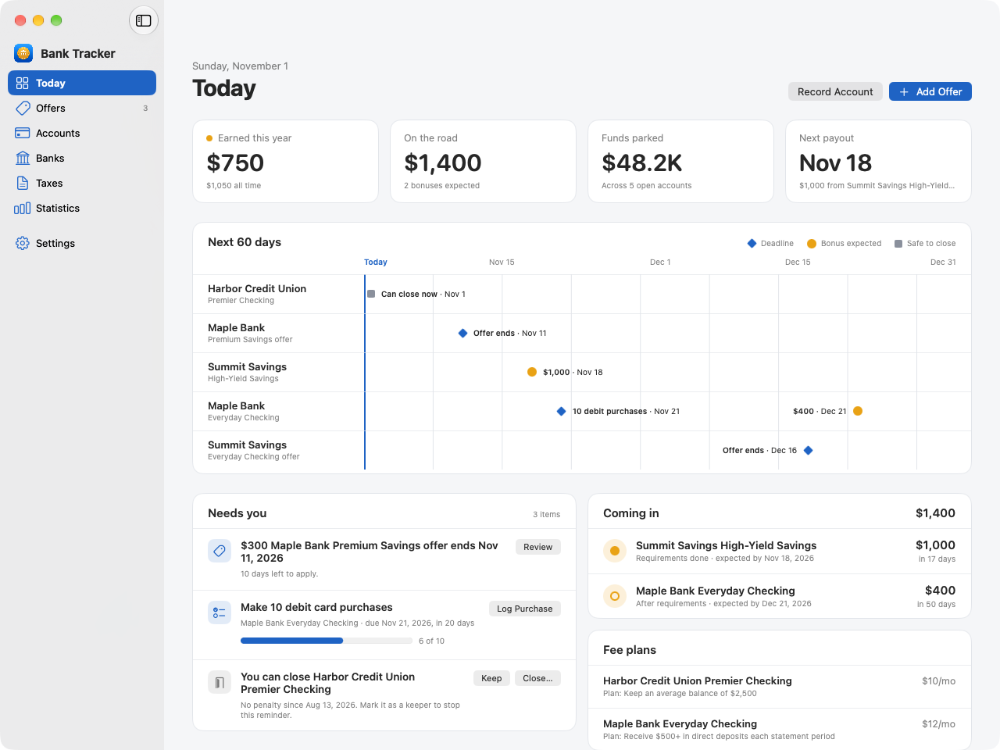

## Features

- **Offers and eligibility.** Enter an offer with its fine-print restrictions: "not available
  to current customers", "no bonus in the past 2 years", "one per lifetime", state limits, or
  anything you check yourself. The app checks them against every account you've recorded at
  that bank and tells you whether you're eligible now, the date you will be, or that you need
  to close an open account first.
- **Fill offers with AI.** Paste an offer's terms, or a link to the offer page, and an AI
  service fills in the form: bank, bonus, requirements, deadlines, payout timing, early-closure
  terms, fees, eligibility rules and more. Works with OpenAI, Claude, Gemini or any
  OpenAI-compatible server (Ollama, LM Studio, OpenRouter…). Set it up in Settings with your own
  API key, which is stored in the Keychain. Only the offer text is sent to the provider.
- **Account checklists.** Opening an account from an offer copies its terms into a checklist
  with deadlines: direct deposits, deposits, balance holds, debit purchases, bill payments.
  Each account shows when the bonus should post, the earliest date you can close without a fee
  or clawback, and how you plan to avoid the monthly fee. Opening the same account again later
  creates a new record, so your full history counts toward eligibility.
- **Dashboard.** Everything due, overdue, waiting to post, safe to close, or expiring soon.
- **Reminders.** Notifications at a time you choose: a few days before a requirement is due and
  on the day, when money on hold can come out, when an account can be closed without a penalty,
  when a bonus is late, and before an offer ends. Tapping one opens the account or offer.
- **Tax checklist.** For each year, the 1099-INT and 1099-MISC forms to expect, grouped by bank.
  A bonus counts in the year it's paid, not the year you opened the account.
- **Statistics.** Total earned, money still "on the road", funds parked, fees, bonuses by year
  and by bank, and how many accounts you've opened recently.
- **Settings.** Your state of residence, used to check offers limited to certain states,
  reminders, the AI provider for filling offers, plus backup, restore and sample data. Open it from the bottom of
  the sidebar or with ⌘,.

## Screenshots

### On the Mac

|                                                                                                   |                                                                                              |
| ------------------------------------------------------------------------------------------------- | -------------------------------------------------------------------------------------------- |
| 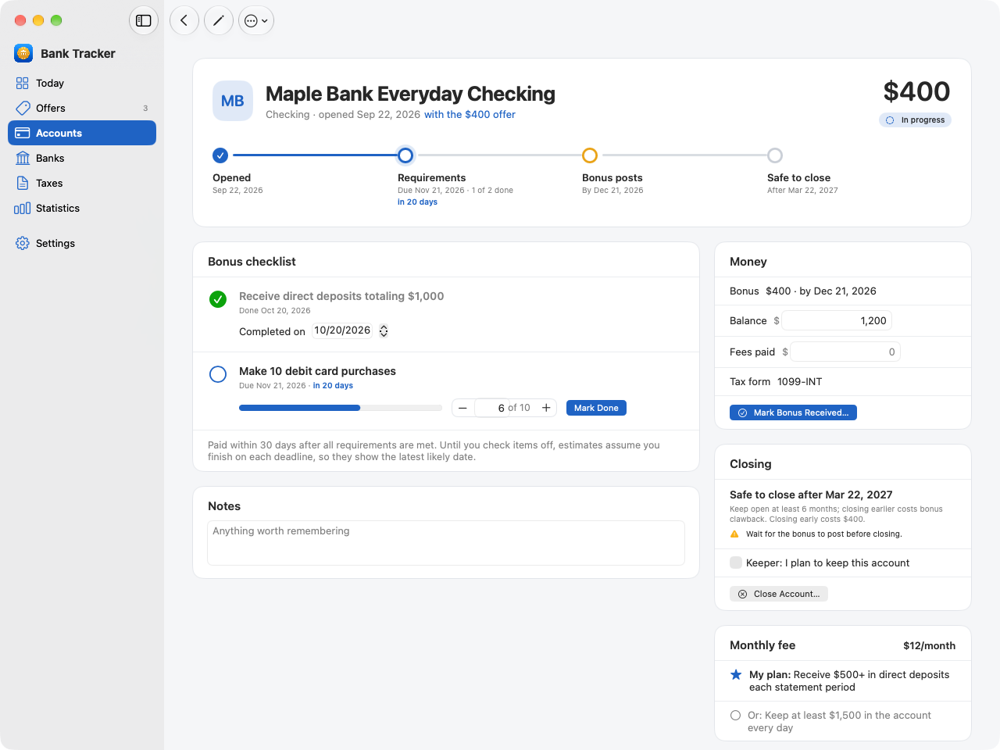    | 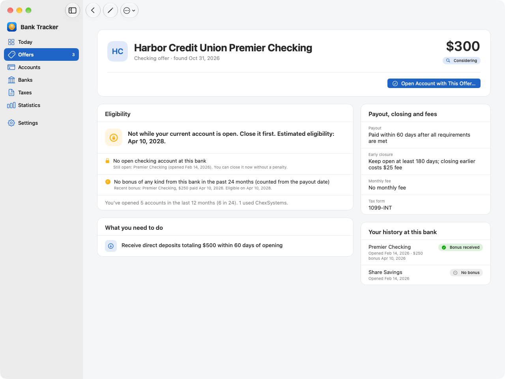 |
| **An account:** the bonus journey, what's left to do, and when it's safe to close                 | **An offer:** whether you qualify, rule by rule, and when you will if you don't yet          |
| 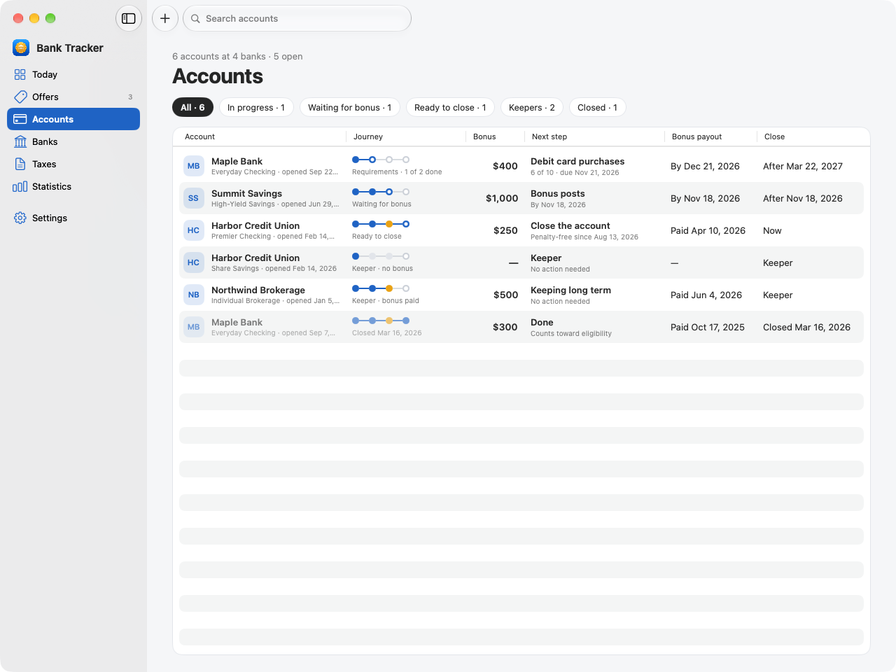 | 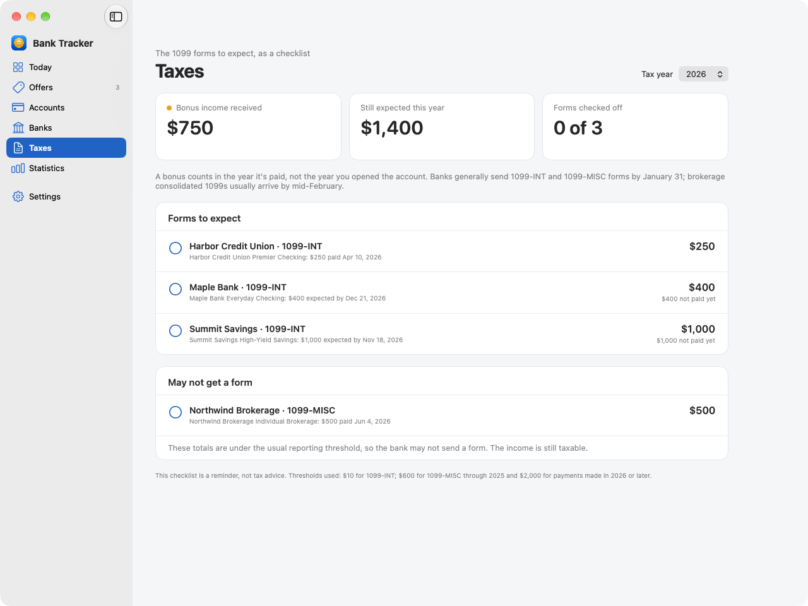                       |
| **Accounts:** every account with its stage and next step                                          | **Taxes:** the 1099 forms to expect, as a checklist                                          |
| 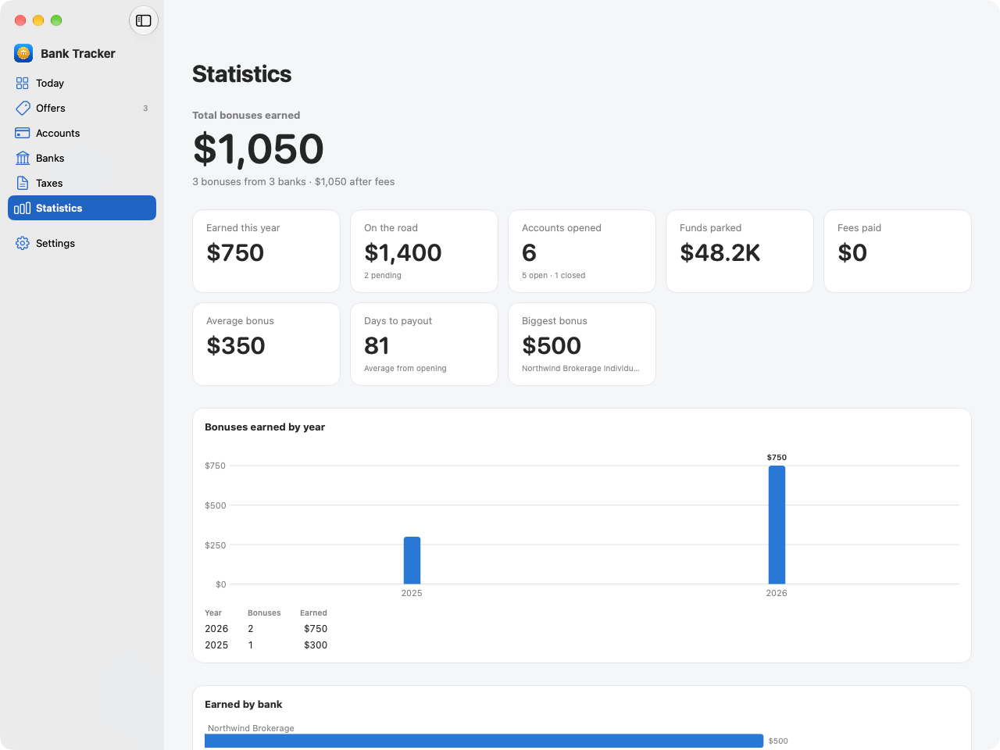                        | 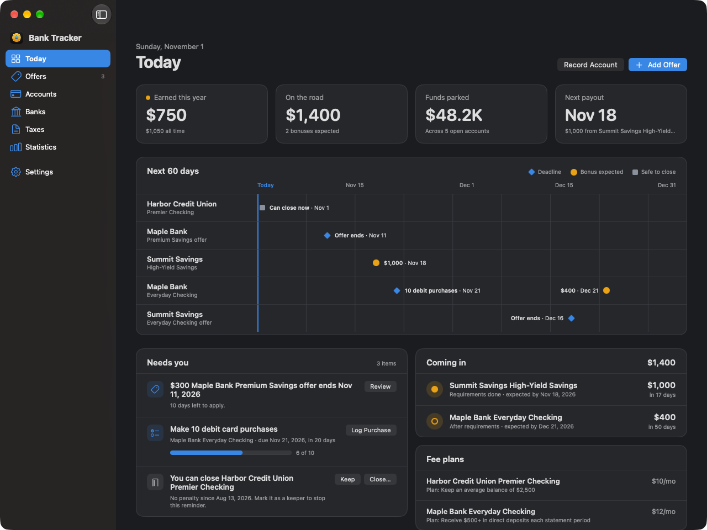                              |
| **Statistics:** totals, bonuses by year and by bank                                               | **Dark mode**                                                                                |

### On iPhone

| Today                                                                                                                                       | An account                                                                                                                                | Offers                                                                                                           | Statistics                                                                                                                         |
| ------------------------------------------------------------------------------------------------------------------------------------------- | ----------------------------------------------------------------------------------------------------------------------------------------- | ---------------------------------------------------------------------------------------------------------------- | ---------------------------------------------------------------------------------------------------------------------------------- |
| 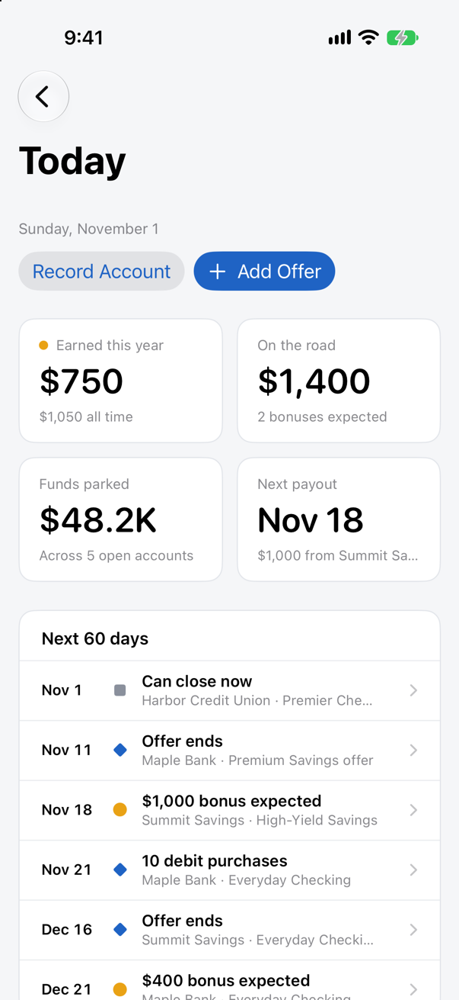 | 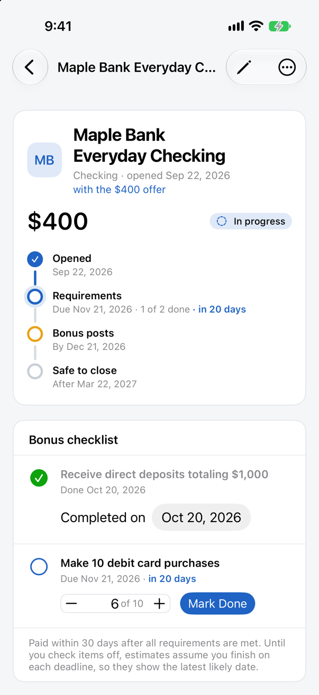 | 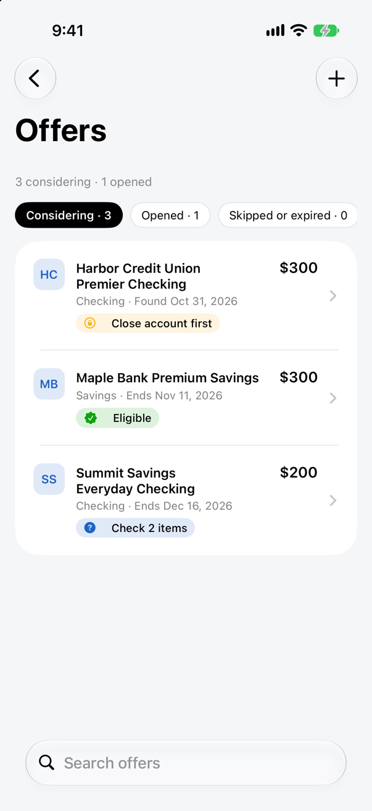 | 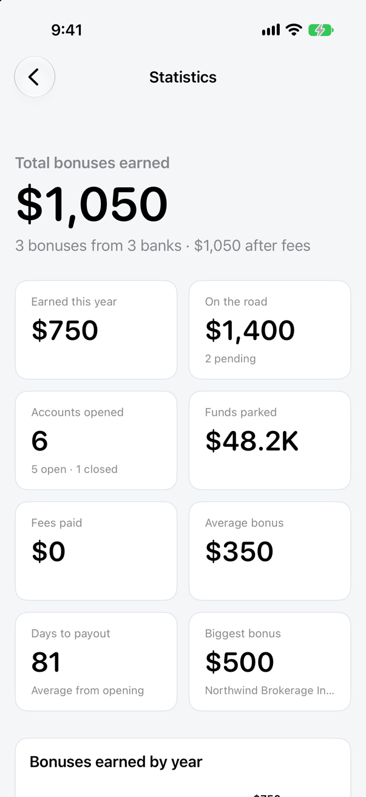 |

The screenshots show the app's fictional sample data. After changing the UI, retake the Mac
ones with `scripts/make-screenshots.sh` (leave the Mac alone for the minute it runs) and the
iPhone ones with `scripts/make-ios-screenshots.sh`, which runs in the iOS Simulator in the
background.

## Requirements

- Xcode 26 or later
- macOS 15 or later to run the Mac app; iOS and iPadOS 18 or later for the mobile builds

## Getting started

1. Open `BankTracker.xcodeproj` in Xcode.
2. Choose the **BankTracker** scheme and **My Mac** as the destination.
3. Run (⌘R).

On first launch the dashboard offers **Try Sample Data**, which adds a few fictional banks and
accounts to your data. Remove them later with **Settings → Delete All Data**.

### Building from Terminal

`scripts/build-mac.sh` builds a Release copy of the app into `build/BankTracker.app`
(a universal app that runs on Apple silicon and Intel Macs):

```sh
scripts/build-mac.sh                    # build only
scripts/build-mac.sh --test --install   # run the tests, build, and copy to /Applications
scripts/build-mac.sh -c Debug --open    # Debug build, then launch it
scripts/build-mac.sh --zip              # also package build/BankTracker-VERSION-macOS.zip
scripts/build-mac.sh --help             # all options
```

Quit the app before using `--install`. Debug and Release builds share the same data.

To check that the iPhone and iPad build still compiles:

```sh
xcodebuild -project BankTracker.xcodeproj -scheme BankTracker -destination 'generic/platform=iOS Simulator' build
```

The app icon is an Icon Composer document, `BankTracker/AppIcon.icon`: a gold coin with a bank
on it, made of Liquid Glass layers on a blue background. Edit it in Icon Composer (Xcode ▸ Open
Developer Tool ▸ Icon Composer). Xcode builds the icon's dark, tinted and clear versions from it,
plus flat icons for macOS 15 and iOS 18. After changing it, refresh the sidebar logo with:

```sh
swift scripts/make-icon.swift
```

### Launch arguments

Set these in Product → Scheme → Edit Scheme → Run → Arguments.

| Argument                                         | Effect                                                                                                                                                                                                                                                                                                            |
| ------------------------------------------------ | ----------------------------------------------------------------------------------------------------------------------------------------------------------------------------------------------------------------------------------------------------------------------------------------------------------------- |
| `--demo`                                         | Uses a throwaway in-memory store filled with sample data. Your real data isn't touched.                                                                                                                                                                                                                           |
| `--section <name>`                               | Opens a section on launch: `dashboard`, `offers`, `accounts`, `banks`, `taxes`, `stats` or `settings`.                                                                                                                                                                                                            |
| `--snapshot`                                     | Debug builds, with `--demo`: saves a PNG of each main screen in light and dark mode to the app's temporary folder, then quits.                                                                                                                                                                                    |
| `--click-test`                                   | Debug builds, with `--demo`: clicks every sidebar row and a row in Offers, Accounts and Banks, prints where navigation ended up, then quits.                                                                                                                                                                      |
| `--ai-fill-test --ai-fill-source <text or link>` | Debug builds, with `--demo`: opens a new offer, fills it with the configured AI provider, prints the result and saves a picture of the form, then quits. Settings can be passed for one run only, e.g. `-ai.provider openAICompatible -ai.baseURL http://localhost:11434/v1 -ai.model.openAICompatible llama3.1`. |
| `--keychain-test`, `--ai-settings-test`          | Debug builds: check Keychain storage and AI settings persistence with throwaway data, then quit.                                                                                                                                                                                                                  |

## How dates are estimated

- **Deadlines** count from the day the account opens.
- **Expected payout** follows the offer's payout rule, such as "within 30 days after all
  requirements are met". Until you check a requirement off, the app assumes you finish it on
  its deadline, so the date shown is the latest likely one. Checking items off moves it earlier.
- **Earliest close date** is the first day closing costs nothing: after the minimum-open
  period, after the bonus posts, and after any balance hold ends. The account page shows what
  closing sooner would cost.

## Tests

The rules live in the `BankTrackerCore` Swift package and are covered by unit tests:

```sh
cd BankTrackerCore && swift test
```

In Xcode, Product → Test (⌘U) runs the same tests.

GitHub Actions ([`.github/workflows/ci.yml`](.github/workflows/ci.yml)) runs them on every push
to `main` and on every pull request, then builds the macOS app and the iPhone and iPad app.
Changes that only touch Markdown files are skipped. It runs on the `macos-26` runner with that
image's default Xcode.

## Releasing

```sh
scripts/release.sh 0.2.0              # or 1.0.0-beta.1 for a pre-release
scripts/release.sh --dry-run 0.2.0    # check everything first, change nothing
```

The script checks that `main` is clean and matches GitHub, then runs the tests and a Release
build on your Mac. Next it sets the app version and bumps the build number in the project, and
commits "Release 0.2.0". Finally it tags the commit `v0.2.0` and pushes both. If the app already
has that version and it was never released, the script only tags the current commit.

The tag starts the Release workflow ([`.github/workflows/release.yml`](.github/workflows/release.yml)).
It tests and builds the universal Mac app, then publishes a GitHub release with
`BankTracker-0.2.0-macOS.zip` and its SHA-256 checksum attached. The release notes are the
install steps in [`.github/release-notes.md`](.github/release-notes.md), followed by notes
GitHub generates from the commits since the last release.

You can also publish a release on GitHub's website with a new tag. The workflow then attaches
the app to that release, keeping your title and notes. The app gets its version from the tag,
which can leave out trailing zeros: `v0.2` is version 0.2.0. The website doesn't change the
project, so update `MARKETING_VERSION` afterwards to keep local builds in step.

To retry a release, or to publish a tag that existed before its release, run the Release
workflow by hand from the Actions tab and enter the tag. Without a tag, the same workflow makes
a test build that isn't published, and keeps the zip as a workflow artifact for a week.

The app is signed ad hoc, not with an Apple Developer ID, and it isn't notarized. So the first
time someone opens a downloaded copy, macOS asks them to approve it in System Settings →
Privacy & Security. The release notes explain how.

## Project layout

```
BankTrackerCore/      Platform-independent rules (no UI, no persistence), with tests
  OfferTerms, BonusRequirement, EligibilityRule   an offer's fine print
  EligibilityEngine   checks rules against your account history
  BonusTimeline       deadlines, expected payout, earliest penalty-free close
  ActionPlanner       the dashboard's to-do list
  TaxCalculator       expected 1099 forms per year
  PortfolioStats      totals and breakdowns
BankTracker/          The SwiftUI app
  App/                Entry point, data store, navigation
  Models/             SwiftData models: Bank, Offer, BankAccount, TaxFormStatus
  Editing/            Drafts behind the editor screens
  Views/              Screens, grouped by sidebar section
  Support/            Sample data, backup, formatting
scripts/              build-mac.sh, install-ios.sh, release.sh, make-icon.swift,
                      make-screenshots.sh, make-ios-screenshots.sh
docs/screenshots/     README screenshots, from the make-screenshots scripts
.github/workflows/    CI and Release workflows for GitHub Actions
```

The project uses folder-synchronized groups, so new files added under `BankTracker/` are
picked up by Xcode without editing the project file.

## Data and privacy

Everything is stored locally with SwiftData. Settings can export a JSON backup and import one;
importing replaces all data in the app. The models are already CloudKit-compatible, so syncing
between Mac, iPhone and iPad later means adding the iCloud capability and changing one line in
`AppDataStore`.

## Roadmap

- Reminder notifications for deadlines, payouts and close dates
- iCloud sync between Mac, iPhone and iPad
- Import from an existing spreadsheet (CSV)
- Track regular interest so 1099-INT totals match the forms exactly
- App icon
